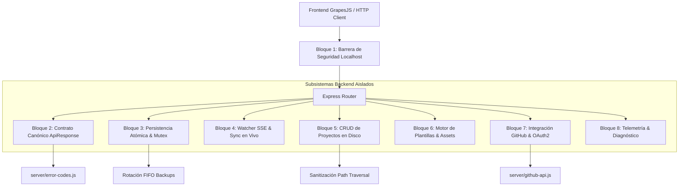

# 🏛️ Manifiesto de Arquitectura del Backend — Rótulos Web v5.1

> **Estudio Visual Memexicanísimos**  
> Guía canónica de división modular, subsistemas aislados, contratos e invariantes del backend Node.js / Express ([`editor/server.js`](file:///home/myinnervoid/Estudio%20Memexicanisimos/Rotulos%20Web/editor/server.js)).

---

## 🎯 Propósito del Manifiesto

Este documento describe **cómo está dividido el backend en bloques independientes de responsabilidad**, qué barreras de aislamiento existen entre ellos y cómo modificar o extender una función sin que un cambio accidental desestabilice el resto del servidor o rompa el frontend.



---

## 1. Los 8 Bloques de Responsabilidad del Backend

El backend se divide en 8 subsistemas autónomos claramente delimitados por fronteras funcionales:

### 🛡️ Bloque 1: Barrera de Seguridad y Red Localhost-Only
* **Ubicación en código:** `editor/server.js` (Líneas 219–302)
* **Responsabilidad única:** Bloquear cualquier intento de acceso que no provenga de la propia máquina (`127.0.0.1` o `::1`). Sanitizar encabezados `Host` para prevenir DNS Rebinding.
* **Aislamiento:** Es un middleware global de entrada. Si rechaza la petición con código 403 `ACCESS_DENIED`, **ningún otro bloque del backend se ejecuta**.
* **Impacto si se edita:** Solo afecta las políticas de red. No toca persistencia, ni proyectos ni plantillas.

---

### 📦 Bloque 2: Contrato Canónico de Respuestas (`ApiResponse<T>`) y Catálogo de Errores
* **Ubicación en código:** 
  - [`editor/server/error-codes.js`](file:///home/myinnervoid/Estudio%20Memexicanisimos/Rotulos%20Web/editor/server/error-codes.js) (Catálogo desacoplado)
  - `editor/server.js` (Líneas 165–194: función `createApiResponse`)
* **Responsabilidad única:** Garantizar que el 100% de los endpoints respondan con la firma universal:
  ```json
  {
    "success": true | false,
    "data": { ... } | null,
    "error_code": "CODIGO_CATALOGO" | null,
    "message": "Explicación legible en español"
  }
  ```
* **Aislamiento:** Este bloque desacopla completamente el frontend del backend. Si el backend cambia su implementación interna, siempre y cuando devuelva `createApiResponse()`, el frontend no sufrirá desbordamientos ni `undefined`.

---

### 💾 Bloque 3: Persistencia Atómica, Mutex y Rotación FIFO
* **Ubicación en código:** `editor/server.js` (Líneas 195–218 y 602–745)
* **Responsabilidad única:** Guardar de forma ultra-segura el HTML y CSS en el archivo activo (`index.html`) sin condiciones de carrera.
* **Mecanismos de aislamiento:**
  1. **Mutex Asíncrono (`saveMutexPromise`):** Encola serialmente múltiples guardados concurrentes. Nunca dos peticiones escriben a la vez.
  2. **Rotación FIFO:** Genera automáticamente un respaldo con timestamp (`index_backup_<FECHA>.html`) en `backups/` y purga si supera el límite (`MAX_BACKUPS = 15`).
  3. **Escritura Atómica:** Escribe en `index.html.tmp` y luego efectúa `fs.renameSync` para que nunca quede un archivo corrupto a medio escribir si se interrumpe la energía.
* **Impacto si se edita:** Está contenido en los endpoints `POST /api/save`. Si cambias la lógica de respaldo, no afecta a las plantillas ni a la lista de proyectos.

---

### 📡 Bloque 4: Watcher SSE y Sincronización Bidireccional
* **Ubicación en código:** `editor/server.js` (Líneas 303–410)
* **Responsabilidad única:** Detectar si el usuario editó un archivo externamente con VS Code o Nano y notificar en vivo al navegador mediante Server-Sent Events (SSE).
* **Endpoints:**
  - `GET /api/watch`: Canal unidireccional persistente (`text/event-stream`).
  - `POST /api/save-file`: Guardado atómico de archivos individuales (`style.css`, scripts) con protección estricta contra Directory Traversal.
* **Aislamiento:** Si el watcher de archivos falla o el cliente desconecta el SSE, la edición visual en el lienzo sigue funcionando normalmente.

---

### 📂 Bloque 5: Gestor CRUD de Proyectos Soberanos en Disco
* **Ubicación en código:** `editor/server.js` (Líneas 1066–1265)
* **Responsabilidad única:** Administrar los espacios de trabajo locales en `~/RotulosProjects` (con fallback a carpeta local del repo).
* **Endpoints:**
  - `GET /api/projects/list`: Lista directorios con metadatos de modificación, tamaño y conteo de backups.
  - `POST /api/projects/create`: Crea un proyecto en blanco o clona una plantilla. Conmuta automáticamente el proyecto activo.
  - `POST /api/projects/duplicate`: Clona profundamente un proyecto existente.
  - `POST /api/projects/rename`: Renombra de forma segura.
  - `POST /api/projects/delete`: Elimina permanentemente en disco.
  - `POST /api/switch-project`: Conmuta en caliente el puntero de trabajo del editor sin reiniciar el servidor Express.
* **Barrera de seguridad:** Toda entrada de usuario pasa por `path.basename()` y resolución absoluta; es imposible salir del directorio base de proyectos.

---

### 🎨 Bloque 6: Motor Desacoplado de Plantillas y Servidor de Assets
* **Ubicación en código:** `editor/server.js` (Líneas 915–1065)
* **Responsabilidad única:** Leer los arquetipos prediseñados en `editor/templates/` y servirlos con sus imágenes y fuentes aisladas.
* **Endpoints:**
  - `GET /api/templates`: Catálogo JSON de plantillas con descripción, categoría y preview.
  - `GET /api/templates/:id`: Devuelve el HTML, CSS y lista de assets de una plantilla específica.
  - `GET /api/templates/:id/assets/*`: Servidor estático seguro con validación anti-traversal para imágenes de plantilla.
* **Aislamiento:** Las plantillas son de **solo lectura**. El usuario nunca edita la carpeta `templates/`; al usar una plantilla, se copia a su proyecto independiente.

---

### 🚀 Bloque 7: Despliegue Remoto a GitHub Pages y OAuth2
* **Ubicación en código:** 
  - [`editor/server/github-api.js`](file:///home/myinnervoid/Estudio%20Memexicanisimos/Rotulos%20Web/editor/server/github-api.js) (Cliente REST soberano)
  - `editor/server.js` (Líneas 1266–1430: Rutas OAuth y publicación)
* **Responsabilidad única:** Conectar con la API de GitHub vía HTTPS nativo (sin dependencias externas pesadas) para crear repositorios y publicar en GitHub Pages con 1 clic.
* **Aislamiento:** Completamente desacoplado. Si el usuario no tiene internet o no usa GitHub, el editor funciona al 100% en modo local sin tocar este subsistema.

---

### 📊 Bloque 8: Telemetría, Diagnóstico y Capturas de Pantalla
* **Ubicación en código:** `editor/server.js` (Líneas 748–914 y 1420–1432)
* **Responsabilidad única:** Proveer telemetría de memoria RSS, estado de respaldos (`/api/stats`), apagado controlado (`/api/shutdown`) y generación de capturas PNG de alta fidelidad (`/api/screenshot`) detectando automáticamente Chrome/Chromium en el sistema.

---

## 2. Invariantes de Aislamiento: ¿Por qué editar un bloque no afecta a los demás?

Para que cualquier desarrollador o IA pueda intervenir el backend con seguridad, se aplican **4 invariantes arquitectónicos**:

1. **Invariante de Contrato Inmutable:**  
   Ningún endpoint puede devolver un JSON arbitrario. Todos deben pasar por `createApiResponse(success, data, errorCode, message)`. Si necesitas agregar un nuevo campo, agrégalo dentro de `data` sin cambiar la raíz.
2. **Invariante de Códigos Centralizados:**  
   Los errores no se escriben como strings libres en las rutas. Se definen en [`editor/server/error-codes.js`](file:///home/myinnervoid/Estudio%20Memexicanisimos/Rotulos%20Web/editor/server/error-codes.js). Esto previene que un cambio de nombre en el backend desconfigure el sistema de mensajes del frontend.
3. **Invariante de Contexto Dinámico (`projectPath`):**  
   Todas las rutas de lectura/escritura consultan `projectPath` a través de los getters (`getActiveIndexPath()`, `getActiveStylePath()`, `getActiveBackupsDir()`). Ninguna ruta tiene hardcodeada una ruta absoluta.
4. **Invariante de Protección de Proceso (`server.on('error')`):**  
   El servidor tiene manejadores globales de `uncaughtException` y `unhandledRejection`. Si una función interna lanza una excepción imprevista, el error se loguea pero **no tira el servidor Node.js**.

---

## 3. Matriz de Guía para Desarrolladores

Si necesitas modificar una funcionalidad específica, consulta esta tabla para saber exactamente a qué bloque dirigirte:

| ¿Qué deseas modificar o agregar? | Bloque a intervenir | Archivo clave |
| :--- | :---: | :--- |
| **Nuevo código de error o mensaje estándar** | Bloque 2 | [`editor/server/error-codes.js`](file:///home/myinnervoid/Estudio%20Memexicanisimos/Rotulos%20Web/editor/server/error-codes.js) |
| **Cambiar cómo se guardan o respaldan los HTML** | Bloque 3 | `editor/server.js` (`POST /api/save`, `rotateBackups`) |
| **Añadir soporte para nuevos archivos en vivo** | Bloque 4 | `editor/server.js` (`POST /api/save-file`, `/api/watch`) |
| **Lógica para clonar, borrar o mover proyectos** | Bloque 5 | `editor/server.js` (`/api/projects/*`) |
| **Nueva plantilla predefinida en el sistema** | Bloque 6 | Crear carpeta en `editor/templates/<nombre>/` |
| **Cambiar la API o endpoints de GitHub Pages** | Bloque 7 | [`editor/server/github-api.js`](file:///home/myinnervoid/Estudio%20Memexicanisimos/Rotulos%20Web/editor/server/github-api.js) |
| **Ajustar capturas de pantalla o consumo de RAM**| Bloque 8 | `editor/server.js` (`/api/screenshot`, `/api/stats`) |
| **Reglas de red, puertos o certificados SSL** | Bloque 1 | `editor/server.js` (Middleware de inicio y creación HTTPS) |
